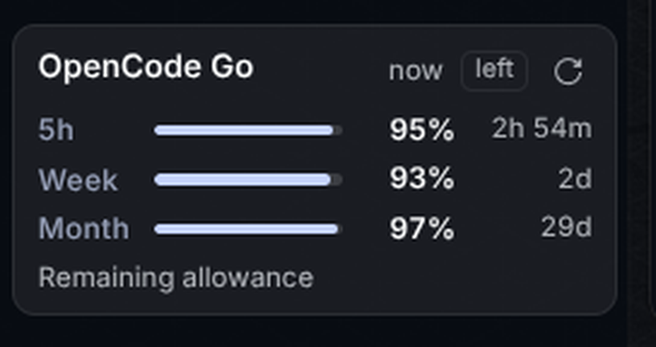

# OpenCode Go Usage

A local OpenCode Desktop plugin that shows the OpenCode Go allowance in the
bottom-left sidebar, under the conversations list: **5-hour**, **weekly**, and
**monthly** quota, with reset times. A `left` / `used` button switches the view.

<p align="center">
  
</p>

## Install

Requires OpenCode Desktop with GUI plugin support and an OpenCode Go
subscription connected in the app.

1. Clone the repository into your global plugins directory:

   ```sh
   git clone https://github.com/TheAliasAlias/opencode-go-usage.git ~/.config/opencode/plugins/go-usage
   ```

2. Add the directory's absolute path to `plugins` in
   `~/.config/opencode/opencode.json(c)`:

   ```jsonc
   {
     "plugins": ["/home/you/.config/opencode/plugins/go-usage"]
   }
   ```

3. Check **Settings → Extensions → Plugins** and make sure **OpenCode Go Usage**
   is enabled.

The desktop app reloads plugins when the config changes; no restart is needed.
To update, run `git -C ~/.config/opencode/plugins/go-usage pull`.

## What it shows

| Row   | API window | Resets                                  |
| ----- | ---------- | --------------------------------------- |
| 5h    | `rolling`  | 5 hours after the first request         |
| Week  | `weekly`   | Monday 00:00 UTC                        |
| Month | `monthly`  | Start of the next paid period           |

- The percentage is **remaining** allowance (`100 - used`) by default.
- The `left` / `used` button in the header switches between remaining and used
  quota for all three rows. The choice is remembered across restarts.
- The bar fills from left to right with the value shown. In `left` mode a full
  bar is good; in `used` mode a full bar means the allowance is exhausted.
- The right-hand text is time until that window resets (`52m`, `3d`, `29d`).
- Hover a row for the exact reset time and both percentages.
- Bars turn amber at 10% or less remaining, and red at 0% or when the limit is
  reached, in either mode.
- The title opens <https://opencode.ai/console/go>; the reload button fetches
  immediately.

Usage is fetched every 60 seconds, when the window regains focus, and on demand.

## How it works

The package has two parts:

- `index.js` — the server part. It reads the active `opencode-go` credential
  through `ctx.integration.connection` and calls
  `GET https://opencode.ai/inference/go/v1/usage` with it. The API key never
  reaches the renderer.
- `gui-experimental.cjs` — the window part. It defines the same RPC contract,
  builds the card with plain DOM APIs (no JSX/bundler), and inserts it before
  `[data-slot="vertical-tabs-footer"]` in the desktop sidebar. If the sidebar
  is not shown (horizontal tabs), it falls back to the `window.bottom` slot.

The endpoint returns percentages used:

```json
{
  "usage": {
    "rolling": { "status": "ok", "percent": 7, "resetsAt": "2026-11-20T23:44:03.000Z" },
    "weekly": { "status": "ok", "percent": 4, "resetsAt": "2026-11-23T00:00:00.000Z" },
    "monthly": { "status": "ok", "percent": 2, "resetsAt": "2026-12-19T13:41:02.000Z" }
  }
}
```

## Disable

Turn the plugin's GUI off in **Settings → Extensions → Plugins**, or remove its
entry from `plugins` in `~/.config/opencode/opencode.json(c)`. Config changes
reload without restarting OpenCode Desktop.

## Troubleshooting

- **"OpenCode Go is not connected."** — Connect Go in the desktop app with
  `/connect` → OpenCode Go so an `opencode-go` credential exists.
- **"OpenCode Go rejected the saved API key."** — Reconnect the integration
  with a fresh key from the console.
- **"Can't reach the OpenCode server."** — The desktop's background server is
  restarting or unreachable; the card retries on the next refresh.
- Server-side errors are logged in `~/.local/share/opencode/log/opencode.log`
  with the `[go-usage]` prefix.

Verify the server half directly:

```sh
opencode api post /api/rpc/go-usage/get --data '{"input":{}}'
```

## Notes

- This is a local, user-installed GUI plugin (GUI APIs are experimental and can
  change between Desktop releases).
- The sidebar is host DOM, so the insert point is a documented data slot but is
  not part of the plugin SDK. If a future release renames
  `data-slot="vertical-tabs-footer"`, the card falls back to the bottom slot.
- There is no build step: edit either file and the running app reloads it.

## License

[MIT](LICENSE)
